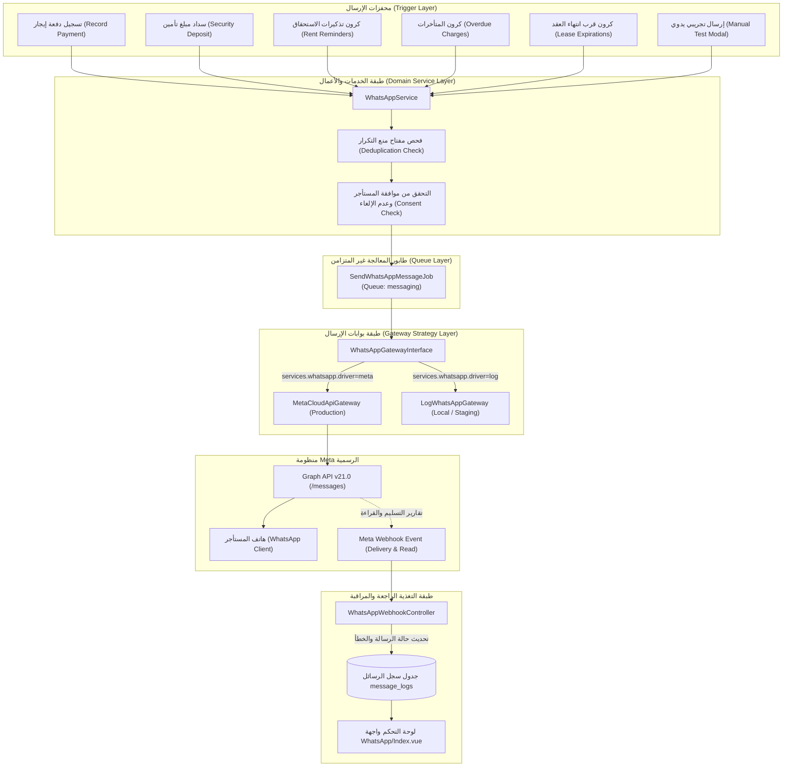

# خطة وتدقيق شامل لميزة واتساب (WhatsApp Feature Architecture, Logic, Audit & Roadmap)

> **وثيقة معمارية وتشخيصية تفصيلية لنظام إشعارات وتذكيرات WhatsApp في منصة إدارة الإيجارات والعقارات (Nook Mate / Dar)**  
> **تاريخ التدقيق:** نوفمبر 2026  
> **الفرع الحالي:** `feature/whatsapp-architecture-and-plan`  
> **الحالة:** تقرير تشخيصي شامل + خطة تصحيحية وتطويرية

---

## الفهرس العام

1. [الملخص التنفيذي والمعمارية الحالية (Executive Summary & Current Architecture)](#1-الملخص-التنفيذي-والمعمارية-الحالية)
2. [آلية العمل وتفاصيل منطق الأعمال (Detailed Workflows & Business Logic)](#2-آلية-العمل-وتفاصيل-منطق-الأعمال)
3. [الأخطاء البرمجية والعيوب المعمارية المكتشفة (What We Are Doing Wrong & Critical Bugs)](#3-الأخطاء-البرمجية-والعيوب-المعمارية-المكتشفة)
4. [النواقص والوظائف المفقودة (What Is Missing)](#4-النواقص-والوظائف-المفقودة)
5. [خطة العمل التصحيحية والتطويرية (Actionable Implementation Roadmap)](#5-خطة-العمل-التصحيحية-والتطويرية)

---

## 1. الملخص التنفيذي والمعمارية الحالية

تم تصميم ميزة WhatsApp في المنصة لتوفير قناة تواصل رسمية وآلية وفورية بين إدارة العقارات (المؤجرين/مكاتب إدارة الأملاك) والمستأجرين، عبر بوابة **Meta WhatsApp Cloud API الرسمية**.

### مخطط البنية المعمارية الحالية (Architecture Flow)



### المكونات الرئيسية في الكود

| المكون | المسار في المشروع | الدور والمسؤولية |
| :--- | :--- | :--- |
| **العقد (Contract)** | `app/Contracts/WhatsAppGatewayInterface.php` | يحدد الواجهة البرمجية الموحدة للإرسال بنمط Adapter/Strategy. |
| **بوابة Meta** | `app/Services/WhatsApp/MetaCloudApiGateway.php` | ينفذ الاتصال بـ Meta Graph API `v21.0` وتهيئة القوالب وأرقام الهواتف. |
| **بوابة التطوير** | `app/Services/WhatsApp/LogWhatsAppGateway.php` | تسجيل الرسائل في ملفات `storage/logs/laravel.log` للاختبار والتطوير دون تكلفة. |
| **خدمة الأعمال** | `app/Services/WhatsAppService.php` | مسؤولة عن إدارة الإرسال، تطبيق منع التكرار، التحقق من رغبة المستأجر، وتجهيز المعاملات. |
| **مهمة الطابور** | `app/Jobs/SendWhatsAppMessageJob.php` | تنفيذ الإرسال غير المتزامن على طابور `messaging` مع قفل منع التداخل `WithoutOverlapping`. |
| **مستقبل الويب هوك** | `app/Http/Controllers/WhatsAppWebhookController.php` | التحقق من صحة توثيق Meta (GET Challenge) واستقبال تقارير التسليم (POST HMAC-SHA256). |
| **وحدة تحكم الواجهة** | `app/Http/Controllers/WhatsAppController.php` | عرض إحصائيات الإرسال، القوالب، السجل، والإرسال التجريبي. |
| **الواجهة الأمامية** | `resources/js/Pages/WhatsApp/Index.vue` | صفحة إدارة ومراقبة واتساب في النظام مبنية بـ Inertia.js و Vue 3. |

---

## 2. آلية العمل وتفاصيل منطق الأعمال (Detailed Workflows & Business Logic)

### أ. القوالب الرسمية المعتمدة والمعاملات (Templates Matrix)

يحتوي النظام حالياً على 4 قوالب إشعار محددة:

```
1. تذكير موعد الاستحقاق (rent_due_reminder_ar)
   - المتغيرات المطلوبة: {1: اسم_المستأجر}، {2: اسم_الوحدة}، {3: مبلغ_القسط}، {4: تاريخ_الاستحقاق}
   - وقت الإطلاق: تلقائياً قبل X أيام من تاريخ استحقاق القسط (يحددها المؤجر من إعدادات مساحة العمل).

2. سند قبض إلكتروني فوري (payment_receipt_instant_ar)
   - المتغيرات المطلوبة: {1: اسم_المستأجر}، {2: المبلغ_المسدد}، {3: رقم_السند}، {4: رابط_السند}
   - وقت الإطلاق: فورياً وبشكل غير متزامن عند تسجيل دفعة إيجارية أو سداد مبلغ تأمين.

3. إشعار متأخرات سداد الإيجار (overdue_notice_ar)
   - المتغيرات المطلوبة: {1: اسم_المستأجر}، {2: اسم_الوحدة}، {3: تاريخ_الاستحقاق}، {4: المبلغ_المتأخر}
   - وقت الإطلاق: بعد انتهاء فترة السماح (overdue_warning_days_after) المحددة في مساحة العمل.

4. تنبيه قرب انتهاء العقد (contract_renewal_ar)
   - المتغيرات المطلوبة: {1: اسم_المستأجر}، {2: اسم_الوحدة}، {3: تاريخ_الانتهاء}
   - وقت الإطلاق: تلقائياً عند المراحل الزمنية: 30 يوماً، 15 يوماً، و7 أيام قبل تاريخ انتهاء العقد.
```

### ب. منطق منع التكرار (Idempotency & Deduplication Engine)

يعتمد النظام على مفتاح `deduplication_key` فريد يُسجل في جدول `message_logs`:

* **سند القبض الإيجاري:** `payment_receipt_{payment_id}`
* **سند سداد التأمين:** `security_deposit_receipt_{payment_id}`
* **تذكير الاستحقاق:** `rent_due_{rent_charge_id}_{due_date}`
* **إشعار المتأخرات:** `overdue_notice_{rent_charge_id}_{due_date}`
* **تنبيه انتهاء العقد:** `lease_renewal_{lease_id}_{days_remaining}d`
* **الإرسال التجريبي:** `manual_test_{timestamp}_{renter_id}`

عند محاولة الإرسال عبر `WhatsAppService::send`:
1. يتم البحث في قاعدة البيانات عن رسالة بنفس المفتاح بدون Global Scopes.
2. إذا كانت حالة الرسالة السابقة `sent` أو `delivered`، يتم إلغاء الإرسال وتفادي الخصم أو إزعاج العميل.
3. إذا كانت الحالة `failed`، يتم السماح بالمحاولة مرة أخرى وزيادة عداد المحاولات `attempts`.

### ج. فحص رغبة العميل وإلغاء الاشتراك (Opt-in / Opt-out Logic)

يحتوي نموذج `Renter` على حقول التوثيق النظامي:
* `whatsapp_opt_in_at`: تاريخ ووقت الموافقة على استلام الرسائل.
* `whatsapp_opt_in_source`: مصدر الموافقة (مثال: `manual_entry`).
* `whatsapp_opt_in_recorded_by`: معرّف الموظف الذي سجّل الموافقة.
* `whatsapp_opted_out_at`: تاريخ طلب إلغاء استلام الرسائل.

إذا كان `whatsapp_opted_out_at !== null`، تتوقف خدمة `WhatsAppService` فوراً عن جدولة أو إرسال أي رسالة للمستأجر.

### د. حلقة التحقق من التسليم عبر الويب هوك (Meta Webhook Cycle)

1. **التحقق من التوثيق (GET):** تستقبل الدالة `verify()` معاملات Meta (`hub_mode`, `hub_verify_token`, `hub_challenge`). إذا تطابق التوكن مع `config('services.whatsapp.webhook_verify_token')`، تُرجع كود التحدي كنص صريح `text/plain`.
2. **استقبال الأحداث (POST):**
   - يتم التحقق من ترويسة التوقيع `X-Hub-Signature-256` عبر مطابقة `hash_hmac('sha256', payload, app_secret)`.
   - يتم استخراج مصفوفة الحالات `statuses[]` من داخل `entry[].changes[].value.statuses[]`.
   - يتم البحث عن السجل المقابل بواسطة `provider_message_id`.
   - يتم تحويل الحالات الواردة: `sent` -> تم الإرسال للمزود، `delivered` أو `read` -> تم التسليم للمستأجر، `failed` -> فشل التسليم مع تخزين `error_code` و `error_message`.

---

## 3. الأخطاء البرمجية والعيوب المعمارية المكتشفة (What We Are Doing Wrong & Critical Bugs)

بعد مراجعة كل سطر برمجي ومطابقته بقواعد Meta Cloud API ومعايير الإنتاج، تم رصد **10 أخطاء وعيوب حرجة**:

### 🔴 الخطأ الأول: روابط سندات القبض معطلة ومحمية بصفحة تسجيل الدخول (404 & Auth Wall)
* **المشكلة:** في `WhatsAppService::queuePaymentReceipt` و `queueSecurityDepositReceipt`:
  ```php
  'link' => url("/payments/{$payment->id}") // لسند الإيجار
  'link' => url("/leases/{$lease->id}")     // لسند التأمين
  ```
* **الأثر الكارثي:**
  1. مسار `GET /payments/{id}` **غير موجود إطلاقاً** في `routes/web.php`! الموجود فقط هو `/payments/{payment}/receipt`. الضغط على الرابط من هاتف المستأجر يُعطي خطأ `404 Not Found` أو `405 Method Not Allowed`.
  2. كل مسارات السندات والعقود تقع داخل مجموعة الميدلوير `auth`:
     ```php
     Route::middleware(['auth', 'verified'])->group(function () { ... });
     ```
     المستأجر لا يملك حساب مستخدم في لوحة تحكم المنصة! فعند فتح الرابط في متصفح هاتفه، يتم تحويله فوراً إلى `/login` ليطلب منه إدخال بريد وكلمة مرور المؤجر!
  3. لا يوجد مسار عام موقّع أو مؤمّن برمز مشفر (Signed Public Guest URL) مخصص للمستأجرين لاستعراض وتحميل السند دون تسجيل الدخول.

### 🔴 الخطأ الثاني: خطأ تكاملي في قاعدة البيانات يمنع الإرسال لغير المستأجرين (NOT NULL Violation)
* **المشكلة:** في ملف التهجير `database/migrations/2026_01_01_000024_create_message_logs_table.php`:
  ```php
  $table->foreignId('renter_id')->constrained()->restrictOnDelete();
  ```
  حقل `renter_id` **إلزامي وغير قابل للقيمة الفارغة (NOT NULL)**.
  بالمقابل، في الدالة `WhatsAppService::send` ومهمة `SendWhatsAppMessageJob`:
  ```php
  public function send(int $workspaceId, ?int $renterId, string $phone, ...)
  ```
* **الأثر:** أي محاولة لاستخدام ميزة واتساب لإرسال إشعار للمالك، أو رقم طوارئ، أو مستأجر محتمل قبل تسجيله، أو رمز توثيق OTP، ستتسبب بانهيار فوري للنظام ورمي استثناء SQL: `Integrity constraint violation: 1048 Column 'renter_id' cannot be null`.
  بالإضافة إلى أن `restrictOnDelete()` يمنع حذف أي مستأجر تجريبي تم إرسال رسالة له إلا بعد مسح سجل الرسائل يدوياً.

### 🔴 الخطأ الثالث: خلط ترتيب المعاملات وانهيار القوالب (Template Parameters Misalignment & Crash)
* **المشكلة:** واجهة Meta Cloud API تعتمد على الترتيب الموضعي للمعاملات (`{{1}}`, `{{2}}`, `{{3}}`). في `MetaCloudApiGateway::sendTemplate`:
  ```php
  foreach ($parameters as $val) {
      $bodyParameters[] = ['type' => 'text', 'text' => (string) $val];
  }
  ```
  هذا الكود يحذف أسماء المفاتيح ويرسل القيم بحسب ترتيب المصفوفة التجميعية!
* **الأثر:**
  1. في `WhatsAppController::testSend`، يتم تمرير مصفوفة ثابتة:
     ```php
     parameters: [
         'renter_name' => $renter->name,
         'unit' => 'الوحدة',
         'amount' => '5,000',
         'due_date' => now()->addDays(3)->format('d/m/Y'),
     ]
     ```
     - إذا اختار المستخدم قالب `contract_renewal_ar` (الذي يقبل 3 معاملات فقط): ترفض Meta الرسالة فوراً لزيادة عدد المعاملات!
     - إذا اختار المستخدم قالب `payment_receipt_instant_ar`: يدخل اسم الوحدة مكان المبلغ، ويدخل المبلغ مكان رقم السند، ويدخل التاريخ مكان الرابط، فتصل رسالة مشوهة ومحرجة للمستأجر!
  2. في كود `WhatsAppService`، قالب `overdue_notice_ar` يمرر المعاملات بترتيب: `[renter, unit, due_date, amount]` بينما قالب `rent_due_reminder_ar` يمرر: `[renter, unit, amount, due_date]`. أي اختلاف بين ترتيب الكود وترتيب اعتماد القالب في Meta سينتج عنه تبديل بين التاريخ والمبلغ.

### 🔴 الخطأ الرابع: ابتلاع الاستثناءات وتعطيل نظام إعادة المحاولة في الطوابير (Swallowed Exceptions)
* **المشكلة:** في `MetaCloudApiGateway::sendTemplate`:
  ```php
  } catch (Throwable $e) {
      Log::error('[WhatsApp Gateway Exception] '.$e->getMessage());
      return [
          'success' => false,
          'provider_message_id' => null,
          'status' => 'failed',
          'error_message' => $e->getMessage(),
      ];
  }
  ```
* **الأثر:** تلتقط البوابة كل أنواع استثناءات الشبكة وانقطاع الاتصال وأخطاء الخادم `5xx` وتُعيد مصفوفة فشل عادية دون رمي أي استثناء!
  المهمة `SendWhatsAppMessageJob` تنتهي بنجاح تام من منظور Laravel Queue، مما يعني أن خصائص إعادة المحاولة المبرمجة في `BaseJob` (`public int $tries = 3;` و `$backoff = [5, 30, 120]`) **معطلة بالكامل ولا تعمل أبداً**! أي تذبذب مؤقت في الاتصال بـ Meta يُسجل الرسالة كـ `failed` نهائياً ولا تتم إعادة محاولتها.

### 🔴 الخطأ الخامس: تضارب وازدواجية المهام المجدولة في `routes/console.php` (Duplicate Cron Schedules)
* **المشكلة:** يحتوي ملف `routes/console.php` على جدولة متكررة ومتضاربة لنفس العمليات:
  ```php
  // 1. تضارب فحص المتأخرات:
  Schedule::job(new CheckOverdueRentChargesJob)->dailyAt('09:00');     // يعمل الساعة 9:00 صباحاً
  Schedule::command('dar:check-overdue')->dailyAt('10:30');            // يعمل الساعة 10:30 صباحاً

  // 2. تضارب تنبيهات انتهاء العقود:
  Schedule::job(new LeaseExpiryReminderJob)->dailyAt('10:00');         // يعمل الساعة 10:00 صباحاً
  Schedule::command('dar:check-expirations')->dailyAt('11:30');        // يعمل الساعة 11:30 صباحاً
  ```
* **الأثر:**
  1. المهمة الأولى `CheckOverdueRentChargesJob` (الساعة 9:00) **تتجاهل فترة السماح المحددة في مساحة العمل** (`overdue_warning_days_after`) وتُرسل إشعار المتأخرات في اليوم التالي للاستحقاق مباشرة، وتستهلك مفتاح منع التكرار! فعندما يعمل الأمر الرسمي `dar:check-overdue` في الساعة 10:30 ليفحص فترة السماح، يجد أن المفتاح استُهلك بالفعل، وتكون الرسالة قد أُرسلت للمستأجر قبل موعدها المحدد من قِبل المؤجر.
  2. استهلاك مضاعف لموارد الخادم واستعلامات مكررة لقاعدة البيانات.
  3. وجود مشكلة N+1 Query في أمر `ProcessLeaseExpirationsCommand` باستدعاء `Workspace::find($lease->workspace_id)` داخل حلقة التكرار.

### 🔴 الخطأ السادس: آلية تكرار المتأخرات تحبس المستأجر في إشعار واحد فقط مدى الحياة
* **المشكلة:** مفتاح منع التكرار لإشعار المتأخرات هو:
  ```php
  $deduplicationKey = "overdue_notice_{$charge->id}_{$dueDateStr}";
  ```
* **الأثر:** بما أن `dueDateStr` هو تاريخ ثابت لا يتغير للدفعة، فإن المستأجر الذي يتأخر عن السداد لمدة 30 أو 60 يوماً **لن يستلم سوى إشعار واحد فقط في اليوم الخامس**! بعد ذلك، لن يرسل النظام أي تذكير للمتأخرات على الإطلاق لأن المفتاح تم تسجيله كـ `sent` في قاعدة البيانات. لا توجد سياسة تصعيد (Escalation Policy) لإعادة الإشعار بعد 15 يوماً أو إشعار نهائي قبل الإجراءات القانونية.

### 🔴 الخطأ السابع: تجاهل رسائل المستأجرين الواردة وانتهاك سياسات Meta الصارمة (Dropped Inbound Messages)
* **المشكلة:** دالة الويب هوك `WhatsAppWebhookController::handle` تستمع فقط لأحداث `statuses[]` وتتجاهل كلياً كائن الرسائل الواردة `messages[]`:
  ```php
  foreach ($this->deliveryStatuses($request->all()) as $statusItem) {
      $this->applyDeliveryStatus($statusItem);
  }
  ```
* **الأثر:**
  1. إذا قام المستأجر بالرد بكلمة **"STOP"** أو **"توقف"** أو **"إلغاء الاشتراك"**، فإن النظام يتجاهلها ولا يُسجل خروجه في `whatsapp_opted_out_at`، مما يمثل **انتهاكاً صريحاً لسياسة Meta التجارية (WhatsApp Business Policy)** وقد يؤدي إلى إيقاف رقم الهاتف وحظر حساب WABA للمنصة.
  2. إذا أرسل المستأجر استفساراً، أو صورة إيصال تحويل بنكي، أو طلب صيانة، تضيع الرسالة في العدم دون تنبيه المؤجر ودون حفظها في سجل المحادثة.

### 🔴 الخطأ الثامن: قصر تهيئة الهواتف على مصر وفرض الجنيه المصري على دول الخليج
* **المشكلة:** في `MetaCloudApiGateway::formatPhoneNumber`:
  ```php
  if (str_starts_with($cleaned, '01') && strlen($cleaned) === 11) {
      $cleaned = '2'.$cleaned;
  }
  ```
  الدالة تعالج فقط الأرقام المصرية التي تبدأ بـ `01`!
  بينما نص القوالب في `WhatsAppController` مكتوب فيه "ج.م" بشكل ثابت:
  ```php
  'sample' => 'بقيمة {المبلغ} ج.م مستحق في {تاريخ_الاستحقاق}...'
  ```
* **الأثر:**
  1. أرقام السعودية (التي تبدأ بـ `05` ومكونة من 10 أرقام) لا يتم تحويلها إلى الصيغة الدولية `9665...`، فتفشل عملية الإرسال عند إدخال المستأجر رقمه المحلي.
  2. إذا كانت مساحة العمل في السعودية أو الإمارات وعملتها `SAR`، يستلم المستأجر في الرياض إشعاراً يطلب منه سداد القسط بالجنيه المصري ("ج.م")!

### 🔴 الخطأ التاسع: ثغرة أمنية في بيئات التطوير والاختبار (Webhook Signature Bypass)
* **المشكلة:** في `WhatsAppWebhookController::handle`:
  ```php
  if (! empty($appSecret) && ! $this->hasValidSignature($request, (string) $appSecret)) {
      return response()->json(['error' => 'Invalid signature'], 401);
  }
  ```
* **الأثر:** إذا كانت بيئة التشغيل غير إنتاجية وكان `WHATSAPP_APP_SECRET` فارغاً، فإن الويب هوك يقبل أي طلب POST من أي مكان على الإنترنت، مما يسمح بحقن حالات وهمية والتلاعب بحالات رسائل المستأجرين. بالإضافة لعدم وجود فحص لحداثة الختم الزمني (Timestamp Freshness) لمنع هجمات إعادة الإرسال (Replay Attacks).

### 🔴 الخطأ العاشر: بيانات وهمية ومؤشرات مضللة في الواجهة الأمامية
* **المشكلة:**
  1. سرعة الإرسال معروضة في `resources/js/Pages/WhatsApp/Index.vue` بقيمة ثابتة مكتوبة يدوياً: `1.2 ثانية (فوري)`، وليست محسوبة من الفارق الزمني بين `scheduled_at` و `sent_at`.
  2. رقم الإرسال الرسمي في حال عدم وجود رقم في البيئة يُعرض كرقم وهمي ثابت: `+20 10 1234 5678`.
  3. كروت السجل لا تعرض للمؤجر سبب الفشل (`error_message` و `error_code`)، مما يترك المؤجر في حيرة تامة عند فشل الرسالة دون معرفة السبب (مثل: رقم غير مسجل بواتساب، أو رفض المعاملات).

---

## 4. النواقص والوظائف المفقودة (What Is Missing)

بناءً على متطلبات التشغيل الفعلي لمنصات PropTech وإدارة العقارات، تنقص الميزة الوظائف الحيوية التالية:

### 1. بوابة المستأجر للوصول للسندات والدفع الإلكتروني (Public Guest Portal)
* **المفقود:** رابط عام موقّع مشفر بصلاحية زمنية مؤقتة (Temporary Signed URL) يتيح للمستأجر:
  - استعراض وتحميل سند القبض الرسمي بصيغة PDF بنقرة واحدة من رسالة الواتساب.
  - إمكانية الدفع المباشر عبر بوابة الدفع الإلكتروني (Apple Pay / Mada / فيزا) بنقرة واحدة دون الحاجة لتسجيل دخول أو إنشاء حساب.

### 2. محرك قوالب تفاعلي يدعم أزرار الإجراء السريع ومرفقات الـ PDF (Interactive Components & Media Header)
* **المفقود:**
  - دعم إرسال ملف PDF الخاص بالسند مباشرة كمرفق في رسالة الواتساب (Document Header Template).
  - دعم أزرار Call-To-Action (CTA) مثل: `[تحميل السند]`, `[سداد الآن]`, `[إلغاء الاشتراك]`.

### 3. حفظ نص ومحتوى الرسالة المرسلة في قاعدة البيانات (Message Body Persistence)
* **المفقود:** جدول `message_logs` لا يحفظ نص الرسالة النهائي ولا المعاملات `payload_parameters`.
  - المالك لا يستطيع قراءة ما أُرسل بالضبط للمستأجر، وهو أمر ضروري جداً في الإثبات القانوني والإخطارات النظامية المعتمدة.

### 4. نظام الحصص (Quotas) وتتبع التكلفة والفوترة
* **المفقود:**
  - حقلا `provider_cost` و `provider_cost_currency` موجودان في الجدول ولكنهما غير مستخدمين إطلاقاً (Dead Code).
  - لا يوجد حد أقصى (Quota) لعدد الرسائل المسموحة لكل مساحة عمل شهرياً حسب باقة الاشتراك.
  - أي مستخدم في باقة مجانية يستطيع إرسال آلاف الرسائل وتحميل فاتورة Meta على صاحب المنصة.

### 5. إدارة عزل الحسابات للمكاتب الكبيرة (Multi-Tenant WABA / Embedded Signup)
* **المفقود:**
  - كل الرسائل تخرج حالياً من رقم واحد خاص بالمنصة، مما يسبب التباساً للمستأجرين إذا كان لكل مكتب عقاري اسم ورقم تجاري مستقل.
  - عدم توفر خيار ربط مساحة العمل بحساب WhatsApp Business خاص بها عبر Meta Embedded Signup.

### 6. استقبال وإدارة الردود وصندوق الوارد المشترك (Two-Way Messaging & Inbox)
* **المفقود:**
  - لا توجد واجهة شات للمؤجر تمكنه من الرد على استفسارات المستأجرين التي تأتي عبر واتساب.
  - عدم وجود ردود آلية ذكية (Auto-responder) خارج أوقات العمل.

### 7. إمكانية إدارة موافقة المستأجر من واجهة المستخدم (UI Consent Toggle)
* **المفقود:**
  - نموذج تعديل المستأجر `UpdateRenterRequest` لا يحتوي على خيار تفعيل أو إلغاء موافقة الواتساب.
  - صفحة المستأجر `Renters/Show.vue` تستلم خاصية `whatsapp_opted_in` لكنها لا تعرضها للمستخدم ولا تتيح تعديلها.

---

## 5. خطة العمل التصحيحية والتطويرية (Actionable Implementation Roadmap)

تم تقسيم خطة التنفيذ إلى **5 مراحل متتالية ومنظمة**:


---

### المرحلة الأولى: الإصلاحات المعمارية العاجلة وضبط الجدولة (Urgent Bug Fixes)

#### الهدف
وقف الأخطاء الفورية في قاعدة البيانات، وإلغاء الازدواجية في مهام الكرون، وتمكين إعادة المحاولات عند فشل الشبكة.

#### المهام التنفيذية
1. **تعديل مخطط جدول `message_logs`:**
   - جعل `renter_id` يقبل `NULL` (`$table->foreignId('renter_id')->nullable()->constrained()->nullOnDelete();`).
   - إضافة عمود `payload_parameters` من نوع `json` أو `text` لتخزين مدخلات الرسالة.
2. **تنظيف وتوحيد مهام الكرون في `routes/console.php`:**
   - إلغاء ازدواجية الجدولة: إزالة `CheckOverdueRentChargesJob` و `LeaseExpiryReminderJob` المباشرين من ملف الجدولة، والاعتماد حصرياً على الأوامر المتكاملة مع مساحات العمل:
     - `dar:send-rent-reminders` (مع مراعاة `auto_whatsapp_reminders` و `rent_reminder_days_before`).
     - `dar:check-overdue` (مع تطبيق فترة السماح `overdue_warning_days_after`).
     - `dar:check-expirations` (مع حل استعلام N+1 بـ Eager Loading لمساحة العمل).
3. **تصحيح استراتيجية معالجة الاستثناءات في `MetaCloudApiGateway`:**
   - عدم ابتلاع الأخطاء التشغيلية المؤقتة (مثل `ConnectException` أو `5xx Server Error`) ورميها ليقوم `SendWhatsAppMessageJob` بإعادة المحاولة تلقائياً طبقاً لسياسة التراجع التدريجي (`backoff`).
4. **تطوير دالة تنسيق الهواتف `formatPhoneNumber`:**
   - دعم التنسيق التلقائي لأرقام مصر (`201...`)، والسعودية (`9665...`)، والإمارات (`9715...`)، وتنظيف الرموز الدولية الزائدة.

---

### المرحلة الثانية: تأمين الروابط الموجهة للمستأجرين وتصحيح القوالب (Public Portal & Safe Templates)

#### الهدف
تمكين المستأجر من فتح السند بدون تسجيل دخول، ومنع انهيار القوالب عند الإرسال التجريبي أو المجدول.

#### المهام التنفيذية
1. **إنشاء مسار عام موقّع لعرض سند القبض:**
   - إنشاء مسار: `GET /p/receipts/{token}` مستقل تماماً عن ميدلوير `auth`.
   - استخدام ميزة `URL::signedRoute` أو توليد رمز وصول فريد مشفر ومحدد بوقت للمستأجر.
   - عرض صفحة سند نظيفة ومهيأة للطباعة والتحميل على الهواتف الذكية.
2. **إنشاء مسار سداد إلكتروني مباشر:**
   - مسار: `GET /p/pay/{charge_token}` يتيح للمستأجر السداد عبر Apple Pay أو البطاقة دون تسجيل الدخول.
3. **تصحيح دالة الإرسال التجريبي `WhatsAppController::testSend`:**
   - تجهيز المعاملات الخاصة بكل قالب بدقة وفقاً لما يتطلبه القالب المعتمد، بدلاً من تمرير مصفوفة موحدة تتسبب برفض الرسالة من Meta.
4. **تعريب وديناميكية العملة:**
   - استبدال رمز العملة الثابت "ج.م" برمز عملة مساحة العمل الفعلي (`$workspace->currencySymbol()`).

---

### المرحلة الثالثة: التوافق مع سياسات Meta وإدارة الاشتراك (Compliance & Opt-out Handling)

#### الهدف
حماية حساب الواتساب من الحظر عبر معالجة طلبات الإلغاء فورياً في الويب هوك.

#### المهام التنفيذية
1. **تحديث دالة الويب هوك `WhatsAppWebhookController::handle`:**
   - قراءة الرسائل الواردة `entry[].changes[].value.messages[]`.
   - في حال كان نص الرسالة يحتوي على: `STOP`, `UNSUBSCRIBE`, `توقف`, `الغاء`, `إلغاء`:
     - يتم تحديث `whatsapp_opted_out_at = now()` للمستأجر المقترن بالرقم.
     - إرسال رد تلقائي مقتضب: *"تم إلغاء اشتراككم في الإشعارات الآلية بنجاح. لإعادة التفعيل يمكنكم التواصل مع إدارة العقار."*
2. **إدارة الموافقة في واجهة المستخدم:**
   - تحديث `UpdateRenterRequest` و `RenterController::update` للسماح بتعديل حالة الموافقة.
   - إظهار شارة حالة الموافقة وزر تفعيل/تعطيل في صفحة المستأجر `Renters/Show.vue`.
3. **سياسة تصعيد المتأخرات (Escalation Deduplication):**
   - تعديل مفتاح المتأخرات ليدعم دورات تذكير متعددة:  
     `overdue_notice_{charge_id}_day{days_overdue}` (مثال: اليوم 5، اليوم 15، اليوم 25).

---

### المرحلة الرابعة: الحصص والتحكم في التكاليف وإثبات الرسائل (Quotas & Financial Tracking)

#### الهدف
حماية المنصة من الاستنزاف المالي وإتاحة إثبات قانوني كامل للرسائل المرسلة.

#### المهام التنفيذية
1. **تفعيل تتبع تكلفة الرسائل `provider_cost`:**
   - تسجيل فئة المحادثة (`utility`, `marketing`, `service`) ومعدل التكلفة عند استلام تأكيد التسليم من Meta.
2. **وضع حصص شهرية حسب خطة الاشتراك:**
   - إضافة عمود `monthly_whatsapp_limit` لجدول خطط الاشتراك ومساحات العمل.
   - التحقق من الرصيد المتبقي قبل جدولة أي رسالة جديدة عبر `WhatsAppService`.
3. **تطوير واجهة الإحصائيات وسجل الرسائل `WhatsApp/Index.vue`:**
   - استبدال المؤشرات الثابتة بحسابات حقيقية من قاعدة البيانات.
   - إظهار تفاصيل أخطاء التسليم (`error_code` و `error_message`) في جدول السجل مع زر إعادة الإرسال اليدوي للرسائل الفاشلة.

---

### المرحلة الخامسة: القوالب الغنية بالمرفقات وصندوق الوارد المشترك (Rich Media & Two-Way Chat)

#### الهدف
الارتقاء بتجربة المستخدم إلى المستوى التفاعلي الكامل.

#### المهام التنفيذية
1. **دعم القوالب ذات المرفقات (Document Header):**
   - إرسال ملف السند الرسمي PDF كملف مرفق بالرسالة مباشرة عبر Meta Media Upload API.
2. **أزرار الإجراءات السريعة (CTA & Quick Reply Buttons):**
   - اعتماد قوالب تتضمن أزرار واضحة: زر فتح السند، وزر الدفع المباشر، وزر طلب صيانة.
3. **صندوق الوارد المشترك (Shared WhatsApp Inbox):**
   - تسجيل الرسائل الواردة غير المخصصة للأوامر الآلية في جدول `inbound_messages`.
   - توفير تبويب محادثات في لوحة التحكم يتيح للمؤجر الرد الفوري على المستأجر عبر Meta Cloud API.

---

## 6. خلاصة التقييم وجدول الأولويات

| الأولوية | البند | نوع المشكلة | الجهد التقديري | الأثر على النظام |
| :---: | :--- | :---: | :---: | :--- |
| **P0 (حرج جداً)** | إصلاح روابط السندات المعطلة وعزلها عن جدار الحماية | Bug / UX Block | نصف يوم | منع ظهور أخطاء 404 وصفحات الدخول للمستأجرين |
| **P0 (حرج جداً)** | حل تضارب مهام الكرون وازدواجية الجدولة في `console.php` | Architecture | 2 ساعة | منع إرسال إشعارات مبكرة وتفادي هدر الموارد |
| **P0 (حرج جداً)** | جعل `renter_id` يقبل القيمة الفارغة في قاعدة البيانات | Database Integrity | 1 ساعة | منع انهيار الإرسال لأي مستلم خارج جدول المستأجرين |
| **P1 (عالي)** | معالجة رسائل إلغاء الاشتراك "STOP" بالويب هوك | Meta Policy Violation | يوم واحد | حماية رقم هاتف المنصة وحساب Meta من الإيقاف والحظر |
| **P1 (عالي)** | ضبط معاملات القوالب في `testSend` وتفادي حذف المفاتيح | Bug / Reliability | يوم واحد | ضمان وصول الرسائل التجريبية والآلية بشكل سليم ومطابق |
| **P1 (عالي)** | تصحيح معالجة الاستثناءات وتفعيل إعادة المحاولة في الطابور | Reliability | نصف يوم | ضمان تسليم الرسائل حتى مع تذبذب الاتصال بـ Meta |
| **P2 (متوسط)** | دعم هواتف الخليج وتغيير العملة ديناميكياً | Localization | نصف يوم | توسيع نطاق العمل بالسعودية والخليج بدون أخطاء عملة |
| **P2 (متوسط)** | تخزين نص ومحتوى الرسائل في جدول السجل | Audit / Compliance | يوم واحد | توفير سجل قانوني كامل للإخطارات الرسمية |
| **P3 (تحسيني)** | تتبع التكاليف والحصص الشهرية لكل مساحة عمل | Billing / Security | يومين | حماية موارد المنصة ومنع الاستخدام المفرط المجاني |
| **P3 (تحسيني)** | صندوق وارد تفاعلي ومرفقات PDF مباشرة | Feature | 3-4 أيام | تقديم تجربة مستخدم عصرية ومتكاملة |

---
*تم إعداد هذا التقرير والخطة المعمارية بواسطة Antigravity لمطابقة أعلى معايير الجودة والاستقرار لمنصة Nook Mate.*
